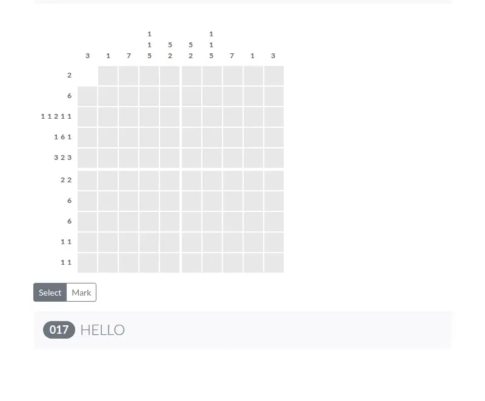

# Pixel Pics

Nonogram puzzles in your browser: use the number hints to uncover a hidden pixel picture, or draw your own and share it as a link.

**[Play it in your browser](https://pixelpics.soleone.xyz)**, no install or account.



## How to play

Each number on the left of a row or above a column is a run of filled tiles in that line, in order. `3 2` means three filled tiles, at least one gap, then two more.

- **Select** (click) a tile you think is part of the picture.
- **Mark** (right-click, or switch the toggle to Mark on a phone) a tile you have ruled out. Marks are only notes for you.
- A hint fades once its line is done. Fill every right tile and the picture is yours.

There are 20 built-in puzzles from 3x3 to 10x10. **Next** and **Random** in the top bar move between them.

## Make your own

Open **Create**, pick the size (3 to 10 tiles each way), name it, and click tiles to draw. The **Share** box always holds a link to the puzzle as drawn so far. Anyone who opens it gets the puzzle to solve, with no server involved: the whole picture is in the link, for example `#/play/3x3:101101101?title=too%20easy` (width x height, then one digit per tile, row by row).

## Run it locally

Needs Node 20 or later.

```sh
npm install
npm run dev      # http://localhost:8080
npm test         # puzzle encoding tests
npm run build    # static site in dist/
```

`npm run media:capture -- --url http://localhost:4173` re-records the gameplay loop against `npm run preview` (needs [agent-browser](https://github.com/vercel-labs/agent-browser) and FFmpeg).

## Built with

Vue 2.7, Vuex, Vue Router, BootstrapVue and Vite. Built in 2018, revived in 2026.
